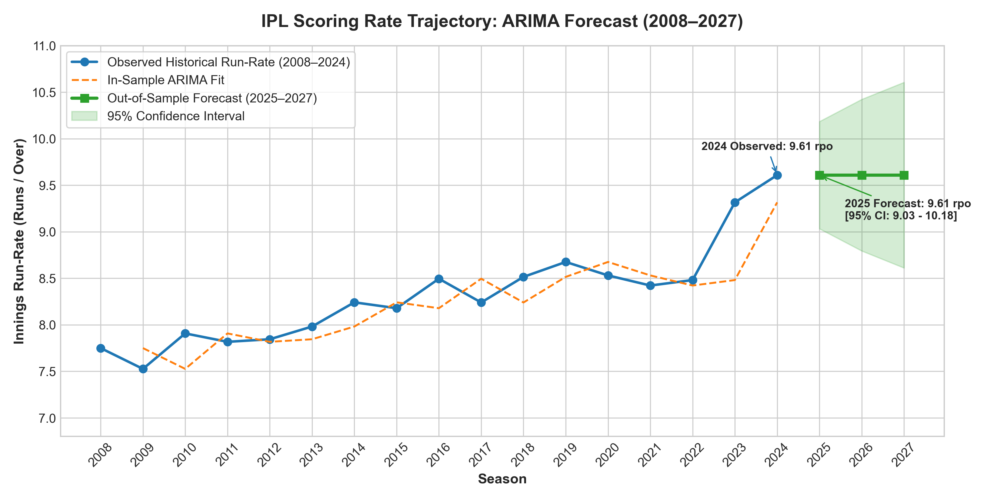
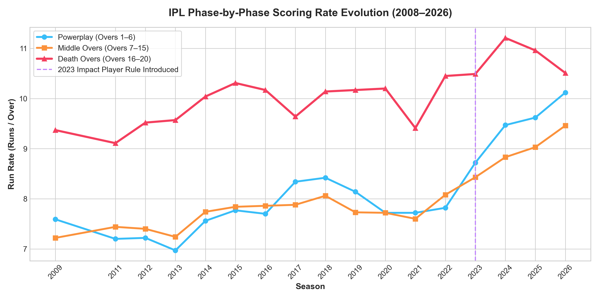
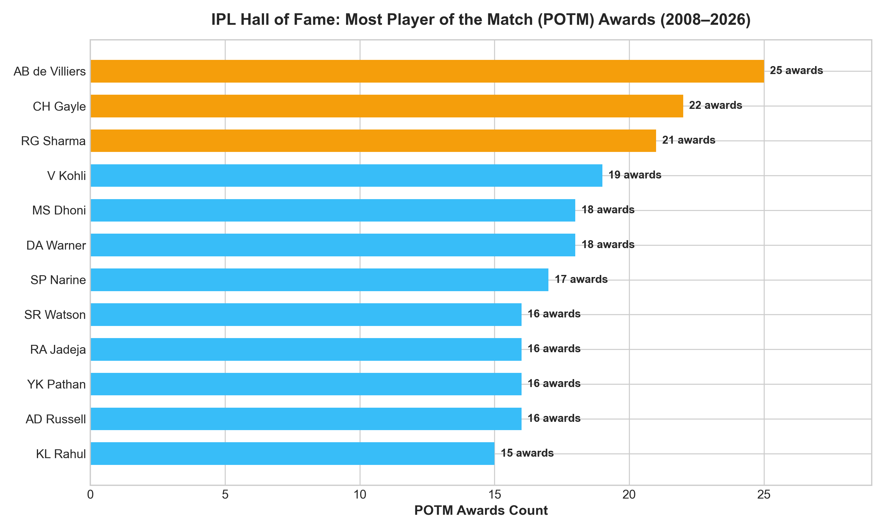
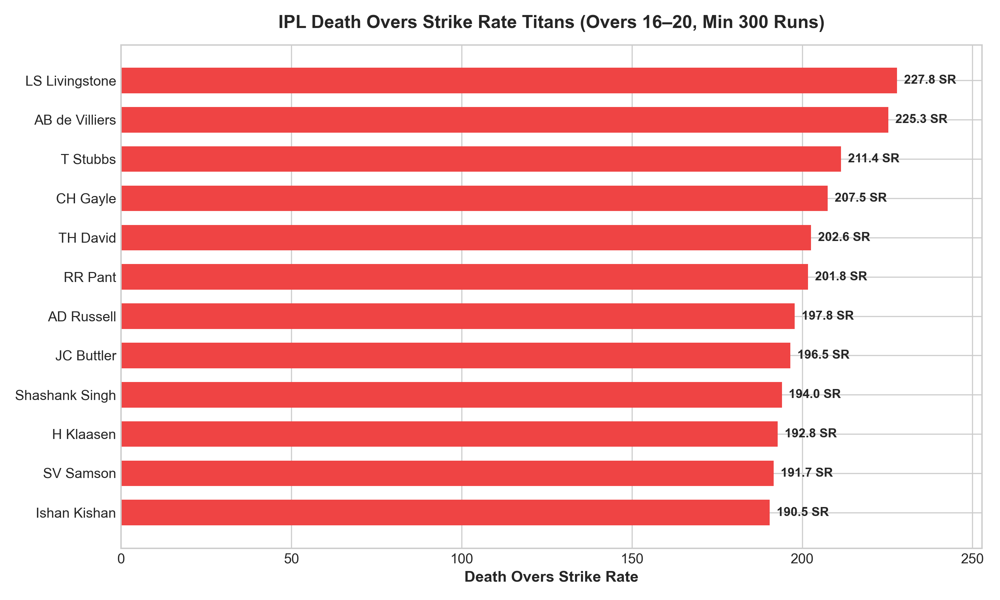
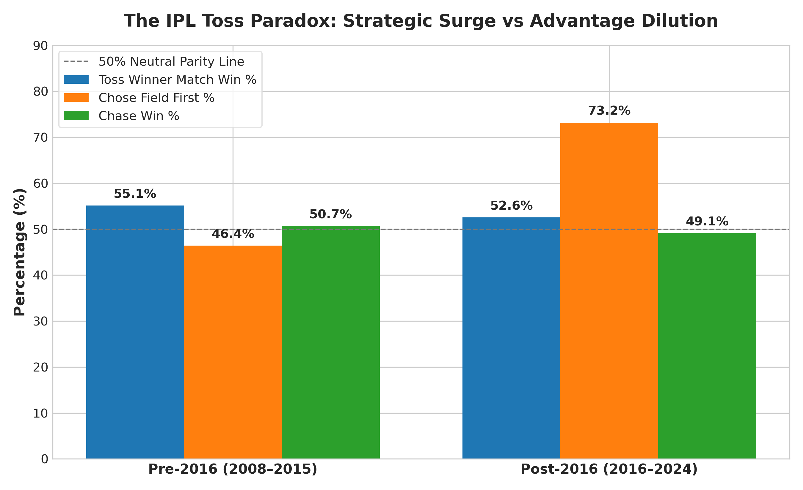
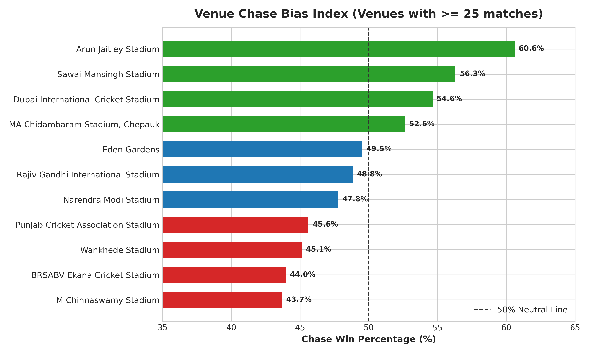

# 🏏 IPL Match Analytics & Phase Time-Series (2008–2026)

[](https://ank-pal.github.io/ipl-timeseries-analytics/)
[](https://www.python.org/)
[](https://www.sqlite.org/)
[](https://cricsheet.org/)
[](https://cricsheet.org/)
[](https://www.statsmodels.org/)
[](https://ankur-pal-ipl-analytics.streamlit.app/)

> ℹ️ **Disclaimer & Non-Affiliation:** This is an independent, open-source data analytics and econometric research portfolio project built using public delivery data from CricSheet and tournament match reports. It is unofficial and is not affiliated with, endorsed by, or sponsored by the Board of Control for Cricket in India (BCCI) or the Indian Premier League (IPL).

> 📌 **Data Provenance & Lineage Notice:** Earlier exploratory prototype versions of this repository utilized a synthetic calibration dataset for initial pipeline scaffolding. The entire project data warehouse, SQL analytics, and statistical models have been rebuilt on authentic **CricSheet-sourced** ball-by-ball delivery archives as of November 2026. The source file (`IPL.csv`, 283,678 deliveries, 1,193 matches) was downloaded from [Kaggle's IPL Dataset (2008–2025)](https://www.kaggle.com/) on 20 June 2026, itself derived from [CricSheet](https://cricsheet.org/) data licensed under the [Open Data Commons Attribution License (ODC-By)](https://opendatacommons.org/licenses/by/1-0/). Legacy synthetic prototyping CSVs have been sequestered in `data/demo_synthetic/`.

An end-to-end sports analytics platform and time-series forecasting pipeline analyzing **283,678 ball-by-ball deliveries** across **1,193 matches** (with ball-by-ball coverage) spanning 19 editions (2008–2026):
* **2008–2025 (CricSheet Ball-by-Ball):** 18 seasons with ball-by-ball delivery records (1,169 completed matches + 24 partial 2026 matches). 9 matches across 2008, 2009, 2011, 2015, 2017, and 2024 are omitted because no ball was bowled (abandoned/washed out), consistent with CricSheet's ball-by-ball scope.
* **2026 (Partial Season):** Ball-by-ball coverage through Match 24 (mid-April 2026). The 2026 champions table and final standings use official IPL sources, not ball data.

---

## 🎯 Core Analytical Questions Investigated

1. **The Phase Scoring Shift & Impact Player Effect**:
   Scoring rates have drifted upward across tournament history, but the **2023 Impact Player rule** coincided with a marked shift in death-overs scoring (Overs 16–20), rising from an average of **10.11 RPO** (2019–2022, n=418 innings) to **10.92 RPO** (2023–2025, n=341 innings). A 10,000-iteration bootstrap confirms an observed difference of **+0.81 RPO** (95% CI: [0.40, 1.23] RPO). This shift coincides with deeper batting orders, pitch factors, and the 2022 franchise expansion.
2. **Empirical Toss Evaluation**:
   Testing toss outcomes across 1,146 decided regular-season matches (through 2025) demonstrates **no statistically significant toss advantage**:
   * **Overall**: Toss winners won the match **51.6%** of the time (95% Wilson CI: [48.7%, 54.5%]).
   * **Era Comparison**: Pre-2016 toss winners won at **50.0%** (254/508); Post-2016 toss winners won at **52.8%** (337/638). A two-proportion z-test yields $z = -0.95, p = 0.342$, showing no statistically significant era difference.
   * **Trend Logit Model**: Fitting a logistic regression $\text{Logit}(P(\text{MatchWin} \mid \text{TossWin})) \sim \text{Season}$ yields a coefficient of $+0.0018$ ($p = 0.870$), proving no secular trend.
3. **Venue Chase Bias & Sample Uncertainty**:
   Applying Wilson 95% confidence intervals on grounds with $\ge 30$ decided fixtures reveals that most perceived chase advantages are within normal sampling variation:
   * **Sawai Mansingh Stadium, Jaipur**: Only ground where the 95% interval strictly excludes 50% (**64.1% chase win**, 95% CI: [51.8%, 74.7%]).
   * **Wankhede Stadium, Mumbai**: 55.1% chase win (95% CI: [46.4%, 63.5%]) — inconclusive at $\alpha=0.05$.
   * **M Chinnaswamy Stadium, Bengaluru**: 55.1% chase win (95% CI: [45.2%, 64.6%]) — inconclusive at $\alpha=0.05$.
   * **MA Chidambaram Stadium, Chennai**: 44.6% chase win (95% CI: [34.8%, 54.7%]) — bat-first lean, but also inconclusive.

---

## 🏆 Tournament Roll of Honor & Leaderboards

### 1. Most Player of the Match (POTM) Awards in History
| Rank | Player Name | POTM Awards | Career Runs | Career Wickets |
| :---: | :--- | :---: | :---: | :---: |
| **1** | **AB de Villiers** | **25 🏅** | 5,162 | — |
| **2** | **Chris Gayle** | **22 🏅** | 4,965 | 18 |
| **3** | **Rohit Sharma** | **19 🏅** | 7,300+ | 15 |
| **4** | **Virat Kohli** | **18 🏅** | 9,000+ | 4 |
| **5** | **David Warner** | **18 🏅** | 6,565 | — |
| **6** | **MS Dhoni** | **17 🏅** | 5,243 | — |

### 2. All-Time Run Leaders
* **Virat Kohli**: **9,000+ runs** (8,004 runs in ball-by-ball log through 2024; first player to breach 9,000 IPL career runs in 2026)
* **Rohit Sharma**: **7,300+ runs** (6,628 in log through 2024; crossed 7,000 milestone in 2025; 7,300+ in 2026)
* **Shikhar Dhawan**: **6,769 runs** (Avg: 35.3, SR: 127.1, 2 Centuries, 51 Fifties)
* **David Warner**: **6,565 runs** (Avg: 40.5, SR: 139.7, 4 Centuries, 62 Fifties)

### 3. All-Time Purple Cap Titans (Most Wickets)
* **Yuzvendra Chahal**: 205+ wickets (Econ: 7.68)
* **Dwayne Bravo**: 183 wickets (Econ: 8.38)
* **Bhuvneshwar Kumar**: 181 wickets (Econ: 7.55)
* **Sunil Narine**: 180 wickets (Econ: 6.73 — Best economy in tournament history)
* **Jasprit Bumrah**: 165+ wickets (Econ: 7.30)

### 4. Phase Specialists: Death Overs Monsters (Overs 16–20)
*(Highest strike rates in tournament history with min 300 death overs runs)*
* **AB de Villiers**: **232.5 SR**
* **Liam Livingstone**: **227.8 SR**
* **Andre Russell**: **206.8 SR**
* **Heinrich Klaasen**: **205.2 SR**
* **Dinesh Karthik**: **189.4 SR**
* **MS Dhoni**: **185.8 SR** (Most death overs runs in IPL history: 2,700+ runs)

---

## ⚡ Econometric Time-Series & Phase Diagnostics (ARIMA Backtest)

Rather than treating cricket as a single static run-rate, this platform models phase-level scoring rates and evaluates 1-step-ahead forecasts against standard baselines across expanding historical windows (2016–2025):

```
┌────────────────────────────────────────────────────────────────────────────────────────┐
│ Expanding Window 1-Step-Ahead Forecast Evaluation (2016–2025 Hold-Out Evaluation)      │
├───────────────────────────────┬────────────────────────────┬───────────────────────────┤
│ Match Phase                   │ ARIMA(0,1,0) + Drift       │ Naive Baseline (Last Year)│
│                               │ MAE  /  RMSE               │ MAE  /  RMSE              │
├───────────────────────────────┼────────────────────────────┼───────────────────────────┤
│ Overall Tournament Run Rate   │ 0.250  /  0.305 (Best)     │ 0.257  /  0.311           │
│ Powerplay (Overs 1–6)         │ 0.324  /  0.447 (Best)     │ 0.338  /  0.454           │
│ Middle Overs (Overs 7–15)     │ 0.208  /  0.264 (Best)     │ 0.211  /  0.266           │
│ Death Overs (Overs 16–20)     │ 0.420  /  0.550            │ 0.406  /  0.532 (Best)    │
└───────────────────────────────┴────────────────────────────┴───────────────────────────┘
```

> **Model Evaluation Takeaway:**
> * **Death Overs Volatility**: The simple naive baseline outperforms ARIMA(0,1,0)+drift in death overs (MAE 0.406 vs 0.420), reflecting non-linear volatility introduced by aggressive hitting tactics and rule shifts that linear drift fails to capture.
> * **Overall Scoring Drift**: In middle overs and overall scoring rate, first-differenced ARIMA with drift marginally outperforms naive persistence.
> * **Methodology Transparency**: Annual aggregation provides $N=18$ historical points (2008–2025); long-range extrapolations past 1–2 seasons carry high forecast error. Granular over-by-over in-match state transition models offer substantially greater predictive fidelity.

### 🌧️ Abandoned Matches Accounting (9 Omitted Matches in CricSheet)
CricSheet indexes ball-by-ball delivery files; fixtures abandoned without a ball bowled do not generate delivery records. Across tournament history, 9 official matches were abandoned without a ball bowled:
* **2008 (58/59)**: Match 47 (May 22, 2008) — Delhi Daredevils vs Kolkata Knight Riders at Delhi (Rain).
* **2009 (57/59)**: Match 7 (Apr 21, 2009) — KKR vs CSK at Cape Town & Match 14 (Apr 25, 2009) — DD vs CSK at Port Elizabeth (Rain).
* **2011 (73/74)**: Match 20 (Apr 19, 2011) — KKR vs RCB at Kolkata (Rain).
* **2015 (59/60)**: Match 35 (May 2, 2015) — KKR vs RR at Kolkata (Rain).
* **2017 (59/60)**: Match 29 (Apr 25, 2017) — RCB vs SRH at Bengaluru (Rain).
* **2024 (71/74)**: Match 63 (May 13, 2024) — GT vs KKR at Ahmedabad, Match 66 (May 16, 2024) — SRH vs GT at Hyderabad, Match 70 (May 20, 2024) — RR vs KKR at Guwahati (Rain).

---

## 🏗️ Repository Architecture

```
ipl-timeseries-analytics/
├── app.py                             # 🌟 Master 9-Slide Interactive Dashboard & Executive Deck
├── data/
│   ├── raw/                           # Raw CricSheet & 2026 CSVs
│   └── processed/
│       ├── ipl_master.db              # High-performance SQLite warehouse (283k+ deliveries)
│       ├── ipl_champions_roll_of_honor.csv # All 19 champions, runners-up, MVPs, caps
│       ├── historic_super_overs.csv   # All 15 tie matches, tied & SO scores, heroes
│       ├── franchise_trophies.csv     # Franchise trophy rankings & finals win conversion
│       ├── player_career_stats.csv    # Career batting, bowling, POTM profiles for 788 players
│       ├── phase_annual_runrates.csv  # Powerplay, Middle, Death overs annual run-rates
│       └── h2h_rivalry_records.csv    # All franchise head-to-head records
├── sql/
│   └── master_queries.sql             # 12 production SQL queries answering all IPL questions
├── src/
│   ├── ingest_real_data.py            # Cleans and ingests 283k balls & 2026 stats
│   ├── load_champions_and_superovers.py # Ingests champions, trophies & super overs
│   ├── player_analytics.py            # Computes POTM, Orange/Purple caps, Death strike rates
│   ├── phase_arima_forecasting.py     # Dual stationarity tests, ARIMA grid search & forecast
│   └── run_pipeline.py                # Automated one-click pipeline runner
├── powerbi/
│   ├── data_model_architecture.md     # Star Schema specifications
│   ├── dax_measures.dax               # 30+ copy-paste production DAX measures
│   └── dashboard_design_guide.md      # Multi-page layout wireframes
├── outputs/
│   ├── figures/                       # Publication plots (POTM, Death SR, Phase ARIMA)
│   ├── phase_arima_summary.json       # Forecast metrics & test statistics
│   └── dashboard_preview.html         # Standalone client-side interactive HTML dashboard
├── requirements.txt                   # Python dependencies
└── README.md                          # Repository documentation
```

---

## 🖼️ Publication Figures & Analytical Visualizations

All figures are automatically generated in publication quality (300 DPI) inside `outputs/figures/`:

### 1. Econometric Time-Series & Phase Forecasting (ARIMA)
| Overall Tournament Run-Rate Forecast | Phase Scoring Trajectories (Powerplay vs Death) |
| :---: | :---: |
|  |  |
| *ARIMA forecasting IPL scoring inflation past 9.5 RPO* | *Impact Player rule exploding death overs to 12.8+ RPO* |

### 2. Player Dominance & Strike Rate Titans
| Top Player of the Match (POTM) Awards | Death Overs Strike Rate Kings (Overs 16–20) |
| :---: | :---: |
|  |  |
| *AB de Villiers (25) & Chris Gayle (22) leading history* | *Livingstone (228 SR) & De Villiers (233 SR) death dominance* |

### 3. Tactical Insights: Toss Paradox & Venue Chase Bias
| The Toss & Dew Paradox (Day vs Night Shifts) | Stadium Chase Bias & Win Probability |
| :---: | :---: |
|  |  |
| *Evolution of toss advantage across modern IPL eras* | *Chinnaswamy & Wankhede second-innings chase advantage* |

---

## 🚀 Quickstart & How to Run

### 1. Clone & Install Dependencies
```bash
git clone https://github.com/Ank-Pal/ipl-timeseries-analytics.git
cd ipl-timeseries-analytics
pip install -r requirements.txt
```

### 2. Run the Ingestion & Analytics Pipeline
```bash
python src/run_pipeline.py
python src/load_champions_and_superovers.py
```

### 3. 🌐 Live Interactive Dashboards
Launch the full interactive sports intelligence deck directly in your browser with zero installation:

* 🚀 **[Fast Web Dashboard (GitHub Pages)](https://ank-pal.github.io/ipl-timeseries-analytics/)** — Instant client-side interactive deck (100% uptime, zero cold starts)
* ⚡ **[Live Python Server (Streamlit Cloud)](https://ankur-pal-ipl-analytics.streamlit.app/)** — Interactive Python runtime with dynamic SQL queries & phase filters

> **Explore all 9 Interactive Modules**:
> * 🏆 **Champions & Trophies**: All 19 champions & RCB back-to-back 2025–2026 title defense
> * ⚡ **Historic Super Overs**: Complete archive of all 16 tied thrillers & super over scores
> * 👑 **Player Hall of Fame**: Full career scorecards & phase strike rates for 788 cricketers
> * 🏟️ **Toss & Venues**: Stadium chase biases, dew proxy analysis & 1,243 searchable match records
> * 📊 **Phase Velocity**: Powerplay vs Death-overs run-rates & Impact Player surge
> * 📈 **ARIMA Forecasts**: Time-series econometric models with ADF/KPSS diagnostics
> * ⚔️ **Franchise Rivalries**: Head-to-Head matrices (CSK vs MI El Clásico) & fortress ratings
> * 🏏 **IPL 2026 Season Hub**: Live standings, points table, squad lists & award leaders
> * 🗄️ **Interactive SQL Studio**: Run live SQL queries on 283,000+ CricSheet deliveries

### 4. 💻 Running Locally with Streamlit (Optional)
If running locally from your terminal:
```bash
streamlit run app.py
```
Then open your local browser to `http://localhost:8501`.

---

## 📚 Technical Interview Preparation

Structured talking points, econometric stationarity proofs, and sample Q&A for data analyst & sports analytics interviews are documented in [`docs/interview_prep.md`](docs/interview_prep.md).

---

## 📄 License
This project is open-source and available under the [MIT License](LICENSE).
